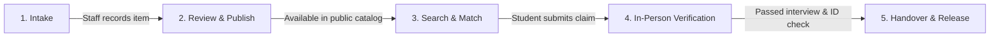

# BalikHub — Campus Lost & Found System

[](https://www.typescriptlang.org/)
[](https://react.dev/)
[](https://vitejs.dev/)
[](https://expressjs.com/)
[](https://www.prisma.io/)
[](https://www.sqlite.org/)

A modern, privacy-focused lost-and-found management platform designed for school guidance offices and campus communities.

---

## 📌 Overview

Traditional lost-and-found setups rely on physical logbooks or public social media posts. This often results in unclaimed belongings, false claims, and accidental exposure of private information (such as student IDs, phone numbers, or card details).

**BalikHub** provides a centralized, secure web application where:
- **Students** can easily search for lost belongings using text or voice.
- **Guidance Staff** log items, keep sensitive details confidential, and verify claims through in-person interviews.
- **Administrators** oversee holding periods, item dispositions (donation/disposal), and system audit logs.

---

## 🌟 Core Highlights

- **Privacy-First Design**  
  Posts separate public descriptions (category, color, general appearance) from private verification details (serial numbers, wallpapers, inner pouch contents). Private details are never shown to the public or sent to claimant search results.

- **Smart Search (English & Taglish)**  
  Students can search naturally in English, Filipino, or Taglish. The search engine automatically maps common terms (e.g., *pitaka* &rarr; *wallet*, *selpon* &rarr; *phone*) and tolerates common typos.

- **Voice Search Support**  
  Integrated browser voice recognition allows students to speak their item description on supported devices.

- **Verified In-Person Handover**  
  To prevent fraudulent claims, items are returned in person at the Guidance Office. Staff verify the claimant's ID and check answers against the private record before signing off on release waivers.

- **End-to-End Custody Tracking**  
  Every action—intake, verification, claim submission, handover, or donation—is recorded in a permanent audit log.

- **Desktop & Mobile Responsive**  
  Optimized for both desktop administrative workstations and mobile phone screens with an in-app device switcher.

---

## 🔄 How It Works



1. **Intake & Logging:** Guidance staff record found items, assign storage locations (bins/shelves), and note finder details.
2. **Review & Redaction:** Staff review public descriptions to ensure sensitive data (like phone or ID numbers) is moved to private notes before publishing.
3. **Search & Claim:** Students search the catalog. When they spot a possible match, they submit a claim request with supporting details.
4. **Verification Interview:** The claimant visits the Guidance Office. Staff ask verification questions based on the private notes and inspect a valid ID.
5. **Release & Handover:** Staff log the physical handover, record the last 4 digits of the ID, and generate an official return waiver.

---

## 👥 User Roles & Access

| Feature | Student / Claimant | Guidance Staff | System Admin |
|---|:---:|:---:|:---:|
| Search Public Items (Text & Voice) | ✅ | ✅ | ✅ |
| View Public Item Catalog | ✅ | ✅ | ✅ |
| View Private Verification Details | ❌ *Hidden* | ✅ | ✅ |
| Submit Claim Requests | ✅ | ❌ | ❌ |
| Record New Found Items (Intake) | ❌ | ✅ | ✅ |
| Conduct Verification Interviews | ❌ | ✅ | ✅ |
| Process Handovers & Release Waivers | ❌ | ✅ | ✅ |
| Configure Holding Periods & Policies | ❌ | ❌ | ✅ |
| Review Item Dispositions (Donation/Disposal) | ❌ | ❌ | ✅ |
| View Complete System Audit Logs | ❌ | ❌ | ✅ |

---

## 🛠️ Tech Stack

- **Frontend:** React 19, TypeScript, Vite 6, Tailwind CSS, Lucide Icons, Framer Motion
- **Backend:** Node.js, Express, TypeScript, JSON Web Tokens (JWT), Bcrypt
- **Database:** SQLite with Prisma ORM
- **Search & Text Processing:**
  - Fast, rule-based Taglish text normalizer and typo matcher built into Node.js
  - Optional Python FastAPI microservice for TF-IDF ranking (`nlp_engine/`)
  - Optional Google Gemini AI integration for automatic attribute extraction

---

## 🚀 Quickstart Guide

### 1. Prerequisites
- **Node.js** (v18 or higher)
- **npm** (comes with Node.js)
- **Git**

### 2. Clone and Install

```bash
# Clone the repository
git clone https://github.com/user-kyo/lost-found.git
cd lost-found

# Install dependencies
npm install
```

### 3. Environment Setup

Create an `.env` file in the project root:

```bash
cp .env.example .env
```

Your `.env` file will look like:
```env
PORT=3000
JWT_SECRET="balikhub-secure-secret-key-2026"
DATABASE_URL="file:./dev.db"

# Optional: Google Gemini API Key for AI attribute extraction
GEMINI_API_KEY=""
```

### 4. Database Setup & Seed

Initialize the SQLite database and seed demo accounts with test items:

```bash
# Sync database schema
npx prisma db push

# Seed demo users and inventory
npx prisma db seed
```

### 5. Start the Application

#### Option A: Quickstart (Frontend + Backend with Built-in Bilingual Fallback)
```bash
npm run dev
```
Open **`http://localhost:3000`** in your browser.  
> **Note:** The Express server automatically launches the Vite development middleware. Both the frontend and backend APIs are served together on port `3000`. The built-in Node.js bilingual search ranker handles Filipino/Taglish queries out-of-the-box.

#### Option B: Full Stack (With Standalone Python TF-IDF NLP Engine)
If you wish to run the dedicated Python TF-IDF vectorization service alongside the main app:
```bash
# Terminal 1: Main Application (Port 3000)
npm run dev

# Terminal 2: Python TF-IDF NLP Engine (Port 8000)
npm run nlp
```
The TF-IDF model will automatically load its persisted state from `backend/data/tfidf_model.joblib`.

---

## 🔑 Demo Accounts

The database comes pre-seeded with test accounts for each institutional role:

| Role | Email | Password | Default ID | Responsibilities |
|---|---|---|---|---|
| **Student / Claimant** | `student@school.edu` | `password123` | `2024-00101` | Search bulletin, report lost property, file claims |
| **Guidance Encoder** | `encoder@guidance.edu` | `password123` | `EMP-2022-088` | Item intake, preliminary verification, custody tagging |
| **Guidance Head** | `head@guidance.edu` | `password123` | `EMP-2015-012` | Approve publication, claim release, and unclaimed dispositions |
| **School Administrator** | `schooladmin@school.edu` | `password123` | `ADM-2018-005` | Read-only executive reports, recovery rate statistics |
| **System Administrator** | `admin@school.edu` | `password123` | `SYS-2020-001` | Technical configurations, user management, audit logs |

---

## 📂 Project Structure

```
lost-found/
├── frontend/                     # React 19 + Vite 6 Single Page Application
│   ├── index.html                # Application HTML entry point
│   └── src/
│       ├── components/           # UI components (student, staff, admin, auth, common)
│       ├── context/              # Global application state (AppContext)
│       ├── services/             # Client API and NLP services
│       ├── types.ts              # Shared TypeScript definitions
│       └── main.tsx              # React entry point & styling
│
├── backend/                      # Node.js Express server & database
│   ├── server.ts                 # Express REST API, auth middleware & Vite dev server
│   ├── transitions.ts            # Centralized state machine, magic-byte checks & audit logging
│   ├── prisma/                   # Database schema, migrations, seed data, and SQLite dev.db
│   ├── nlp_engine/               # Python FastAPI service for TF-IDF matching (main.py, model.py)
│   ├── data/                     # Lexicon (lexicon_fil_en.csv) and persisted model (tfidf_model.joblib)
│   └── tests/                    # End-to-end integration and security test suite
│
├── package.json                  # Root dependencies, scripts, and Prisma configuration
├── tsconfig.json                 # TypeScript compiler configuration
├── vite.config.ts                # Vite build and development configuration
└── README.md                     # Project documentation
```

---

## 🧪 Testing & Verification

You can run the automated end-to-end test suite at any time:

```bash
# Run all verification tests (Workflow, Security, Schema, and NLP)
npm run test:all

# Or run specific test suites:
npm run test:nlp      # TF-IDF persistence, bilingual fallback & Guidance policies
npm run test:tasks    # Tasks 1 to 6 audit verification (transitions, concurrency, audit logs)
npm test              # Intake workflow verification
```


---

## 📄 License

This project is licensed under the [MIT License](LICENSE).
